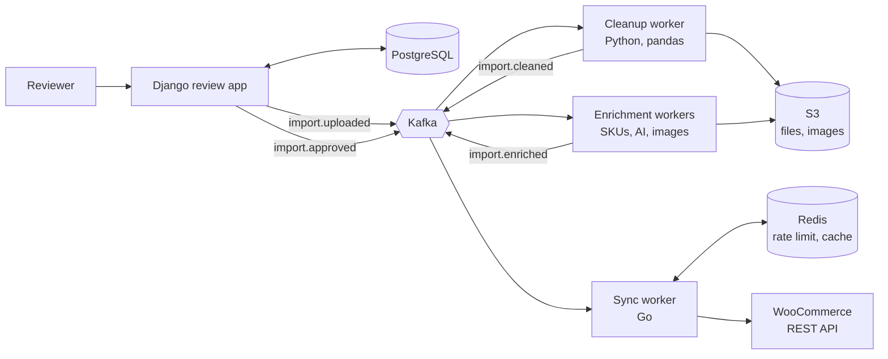

# ImportPilot

An event-driven pipeline that turns messy supplier spreadsheets into clean, reviewed products in a WooCommerce store, with a human approval step before anything goes live.

> **Status: in development.** Built for a laboratory supplies retailer. This public repository uses sample data only; no real supplier files, prices or credentials are included.

## The problem

Importing supplier catalogs into the store was slow and error-prone:

- **6+ hours** of manual cleanup per supplier file, and **500+ errors** per import
- Units, pack sizes and categories written inconsistently across suppliers
- Generated SKUs colliding with SKUs already in use
- Imports of up to 4,000 products timing out unless PHP limits were raised to 2 GB
- Oversized images, plus hand-gathered image URLs and product descriptions

## How it works

1. **Upload:** a supplier CSV or Excel file is uploaded as-is.
2. **Clean:** rules standardize units, pack sizes and prices, remove duplicates and map categories. Rows that can't be fixed are flagged with a reason.
3. **Enrich:** each product gets a guaranteed-unique SKU, an AI-suggested category and description (from the vendor's product page), and compressed images.
4. **Diff:** each row is compared with the live store and labeled new, changed or unchanged, with field-by-field changes.
5. **Review:** a person approves, fixes or rejects rows. Nothing reaches the store without approval.
6. **Sync:** approved images and products are sent to WooCommerce in rate-limited batches, matched by SKU so re-runs never create duplicates.

## Architecture



Everything runs in containers on Kubernetes (k3s), with Prometheus and Grafana for metrics.

## Tech stack

| Layer | Technology |
| --- | --- |
| Review app | Django (admin-based review screens, auth, migrations) |
| Cleanup and enrichment | Python, pandas, an LLM API, an image library |
| Store sync | Go |
| Data | PostgreSQL, Redis, S3 |
| Messaging | Kafka |
| Infrastructure | Docker, Kubernetes (k3s), KEDA |
| Observability | Prometheus, Grafana |
| CI | GitHub Actions |

## Design decisions

- **Separate app, not a WordPress plugin.** Heavy processing runs off the store's server, so large imports don't slow the storefront or hit PHP limits.
- **Approval-gated.** AI output and every change are suggestions until a person approves them.
- **Safe re-runs.** Products are matched by SKU, so running a sync twice never duplicates anything.
- **Django owns the schema.** Only Django migrations change the database structure; the Go worker reads and writes rows but never alters tables.
- **Why Kafka at this scale.** Stages run independently, and an import can be replayed after a cleanup rule is fixed. A PostgreSQL job table would also work at current volume; Kafka was chosen to keep stages decoupled and to learn it.

## Roadmap

- [ ] Self-hosted WordPress/WooCommerce copy for safe testing
- [ ] Cleanup rules and SKU generation
- [ ] Django review screen and Go sync worker (simple products)
- [ ] Variable products (up to 5 attributes)
- [ ] Image pipeline (find, verify, resize, de-duplicate, upload)
- [ ] AI categories and descriptions
- [ ] Metrics, dashboard and Kubernetes deployment
- [ ] First production import

## Running locally

Setup instructions will be added as each service lands. The goal is a single command:

```bash
cp .env.example .env
docker compose up
```

## Author

Prerana Putrevu · [LinkedIn](https://www.linkedin.com/in/prerana-putrevu/) · [GitHub](https://github.com/pputrevu-sys)
